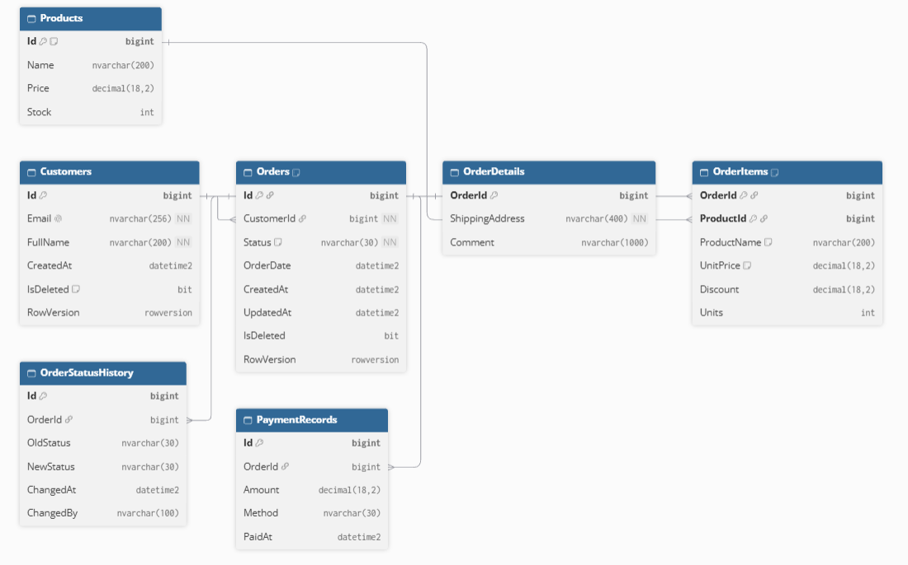
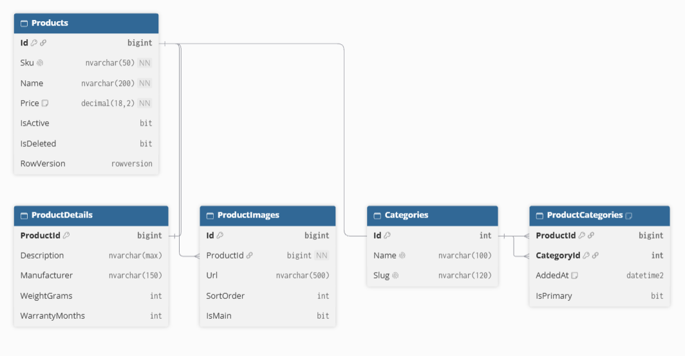

# Практичне заняття №01 — проєктування БД для мікросервісної архітектури

Предметна область: **інтернет-магазин** (3 контексти, 3 незалежні БД, жодних FK між ними).

**Опис домену.** Покупці переглядають каталог товарів, оформлюють і оплачують замовлення та залишають відгуки й обговорюють товари. Система розділена на три автономні сервіси, кожен має власну БД.

| № | Контекст (Bounded Context) | БД | Технологія | Сутності |
|---|---|---|---|---|
| 1 | Замовлення | `OrdersDb` | SQL Server + ADO.NET/Dapper | Customers, Orders, OrderDetails, OrderItems, Products (локальна копія), OrderStatusHistory, PaymentRecords |
| 2 | Каталог | `CatalogDb` | SQL Server + EF Core | Products, ProductDetails, ProductImages, Categories, ProductCategories |
| 3 | Відгуки | `ReviewsDb` | MongoDB | reviews, discussions, discussion_messages, product_ratings |

Агрегати: **Order** = Orders + OrderDetails + OrderItems (+ історія); **Product** = Products + ProductDetails + ProductImages (+ зв'язки з категоріями); **Review** = review + вбудовані comments; **Discussion** = discussions + (reference) discussion_messages.

## Структура репозиторію
```
README.md                    опис домену, розгортання, таблиця дублювання
docs/                        ERD-діаграми, приклади документів MongoDB
db/p1/                       Проєкт №1 (OrdersDb): schema.sql, procedures.sql, seed.sql, tests.sql, security.sql
db/p2/                       Проєкт №2 (CatalogDb): schema.sql, seed.sql, security.sql
db/p3/                       Проєкт №3 (ReviewsDb, MongoDB): collections.js, seed.js, queries.js
```

## Вимоги
SQL Server (Developer/Express/Docker), `sqlcmd`, MongoDB 6+ (локально або Docker), `mongosh`.

Docker (за потреби):
```bash
docker run -d --name mssql -e ACCEPT_EULA=Y -e MSSQL_SA_PASSWORD='Your_strong_Passw0rd' -p 1433:1433 mcr.microsoft.com/mssql/server:2022-latest
docker run -d --name mongo -p 27017:27017 mongo:7
```

## Розгортання з нуля
Параметр `-I` (QUOTED_IDENTIFIER ON) **обов'язковий** — потрібен для фільтрованих індексів.
Для Windows-автентифікації: `-S . -E`; для Docker: `-S localhost -U sa -P "Your_strong_Passw0rd" -C`.

**Проєкт №1 — OrdersDb**
```bash
cd db/p1
sqlcmd -S . -E -I -i schema.sql       # 1) таблиці, зв'язки, обмеження, індекси, view
sqlcmd -S . -E -I -i procedures.sql   # 2) 6 збережуваних процедур + тип OrderItemList
sqlcmd -S . -E -I -i seed.sql         # 3) тестові дані (повторний запуск безпечний)
sqlcmd -S . -E -I -i security.sql     # 4) окремий логін застосунку (найменші привілеї)
sqlcmd -S . -E -I -i tests.sql        # 5) перевірки: CRUD, пагінація, недопустимий перехід статусу
```
**Проєкт №2 — CatalogDb**
```bash
cd db/p2
sqlcmd -S . -E -I -i schema.sql
sqlcmd -S . -E -I -i seed.sql
sqlcmd -S . -E -I -i security.sql     # окремий логін застосунку
```
**Проєкт №3 — ReviewsDb (MongoDB)**
```bash
cd db/p3
mongosh "mongodb://localhost:27017" collections.js   # 1) колекції, JSON Schema-валідація, індекси
mongosh "mongodb://localhost:27017" seed.js          # 2) тестові дані (повторний запуск безпечний)
mongosh "mongodb://localhost:27017" queries.js   # приклади запитів і агрегацій
```
Приклади документів у форматі JSON (Extended JSON): `docs/sample_documents.json`.
## ERD-діаграми
Джерела для dbdiagram.io лежать у `docs/` (`erd-orders.dbml`, `erd-catalog.dbml`): вставте текст на https://dbdiagram.io/d.

**Проєкт №1 (OrdersDb):** 

**Проєкт №2 (CatalogDb):** 

## Типи зв'язків
| БД | 1:1 | 1:N | M:N |
|---|---|---|---|
| OrdersDb | Orders — OrderDetails (PK=FK) | Customers → Orders; Orders → OrderStatusHistory/PaymentRecords | Orders ↔ Products через OrderItems |
| CatalogDb | Products — ProductDetails (PK=FK) | Products → ProductImages | Products ↔ Categories через ProductCategories (AddedAt, IsPrimary) |

## Збережувані процедури OrdersDb
| Процедура | Призначення |
|---|---|
| `usp_CreateCustomer` | CRUD: створення клієнта |
| `usp_CreateOrder` | транзакція: Order + Details + Items (знімок назви/ціни) + історія |
| `usp_GetOrder` | читання замовлення (2 result sets) |
| `usp_GetCustomerOrders` | фільтр за статусом + пагінація |
| `usp_ChangeOrderStatus` | **транзакційна зміна статусу**, UPDLOCK, перевірка переходу, керована помилка 50002, запис історії й оплати |
| `usp_DeleteOrder` | м'яке видалення (лише Submitted/Cancelled) |

Переходи: `Submitted → AwaitingValidation → StockConfirmed → Paid → Shipped`; `Cancelled` — лише до оплати.

## Політика дублювання даних та узгодженості
| Поле | Де зберігається | Джерело (власник) | Політика узгодженості |
|---|---|---|---|
| `OrderItems.ProductName`, `UnitPrice` | OrdersDb | Product (CatalogDb) | знімок на момент оформлення — **не оновлюється** |
| `Products.Name`, `Price`, `Stock` (локальна копія довідника) | OrdersDb | Product (CatalogDb) | оновлюється подіями з Каталогу (eventual consistency, Лаб. 08) |
| `reviews.productName`, `discussions.productName` | ReviewsDb | Product (CatalogDb) | оновлюється подіями з Каталогу |
| `reviews.productId`, `OrderItems.ProductId` | OrdersDb, ReviewsDb | Product (CatalogDb) | лише ідентифікатор, **без FK**; цілісність перевіряє застосунок |
| `reviews.author.userId` | ReviewsDb | Customer (OrdersDb) | лише ідентифікатор, без FK |
| `reviews.author.displayName` | ReviewsDb | Customer (OrdersDb) | копія для читання, оновлюється подією `CustomerRenamed`; у старих відгуках допустимо лишати знімок |
| `product_ratings.*` | ReviewsDb | reviews (той самий контекст) | похідна статистика, перераховується застосунком при зміні відгуку |

## Ключі та конкурентність
- `BIGINT IDENTITY` — для OrdersDb/CatalogDb (послідовна вставка з одного джерела); `Products.Id` в OrdersDb — **не IDENTITY**, Id генерує Каталог.
- MongoDB: `ObjectId` — генерується на клієнті, без координації.
- Аудит: `CreatedAt/By`, `UpdatedAt/By`, `IsDeleted`; `ROWVERSION` — оптимістична конкурентність (процедура приймає `@ExpectedRowVersion`).
- Каскади: `ON DELETE CASCADE` лише для залежних частин агрегату (OrderDetails, OrderItems, ProductImages); `Orders → Customers` — без каскаду.

## Безпека (найменші привілеї)
- `OrdersDb`: логін `orders_app` має лише `SELECT` та `EXECUTE` на схему `dbo` (запис — тільки через збережувані процедури, прямий INSERT/UPDATE/DELETE у таблиці заборонено).
- `CatalogDb`: логін `catalog_app` має `SELECT/INSERT/UPDATE/DELETE` лише у своїй БД, без права змінювати схему; міграції виконує окремий адмін-логін.
- Кожен логін бачить тільки свою базу. Паролі в `security.sql` — тестові, їх треба змінити.

## Версіонування та міграції
- SQL: скрипти зберігаються разом із кодом сервісу і ідемпотентні (`IF NOT EXISTS`, `CREATE OR ALTER`). Для `CatalogDb` у Лаб. 03 схему буде перенесено в EF Core Migrations.
- MongoDB: схема контролюється через JSON Schema Validation (`collections.js`), повторний запуск оновлює валідатор через `collMod`.

## Самоперевірка
1. `SELECT * FROM sys.foreign_keys` у кожній БД — усі FK лише всередині своєї БД.
2. `tests.sql` крок 4: «відвантажити» неоплачене → помилка 50002, а не зміна статусу.
3. `db.reviews.find()` у MongoDB показує документи з різними наборами полів (`photos`, `pros/cons`, `videoUrl`, `author.badge`).
4. Повторний запуск `seed.sql` / `seed.js` не збільшує кількість записів.
